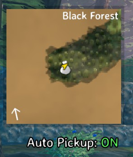

# Auto Pickup HUD Indicator

Shows whether auto pickup is enabled, styled like the vanilla HUD status effects
(Fire, Wisplight, ...) instead of a separate panel: the state is green when on and
red when off.

## Requirements

- Valheim (Steam)
- [BepInEx 5](https://github.com/BepInEx/BepInEx/releases)

## Install

1. Install BepInEx 5 into your Valheim folder.
2. Copy `AutoPickupHUD.dll` to `BepInEx/plugins/`.
3. Launch the game.


## Build from source

The project references the game and engine assemblies from your own Valheim
install. No game or Unity assemblies are stored in this repository, so you need a
legitimate copy of the game to compile it.

Copy `local.props.example` to `local.props` and point `ValheimDir` at your
   install:

   ```xml
   <ValheimDir>E:\SteamLibrary\steamapps\common\Valheim</ValheimDir>
   ```

   `local.props` is gitignored, so your path stays out of the repository.
3. Build:

   ```powershell
   dotnet build -c Release
   ```

4. The plugin is written to `bin\Release\net472\AutoPickupHUD.dll`.

`ValheimDir` can also be supplied without `local.props`:

- set a `VALHEIM_DIR` environment variable, or
- pass it for a single build: `dotnet build -p:ValheimDir="D:\Games\Valheim"`.

If the path is wrong, or BepInEx is not installed in that folder, the build stops
with `VH001` instead of a list of missing types.

## Example image



## Notes

- Client-side only (`[BepInProcess("valheim.exe")]`); a dedicated server does not
  need it.
- The indicator mirrors `Player.m_enableAutoPickup`, i.e. the global auto pickup
  toggle, so it applies to whoever is playing.
- Originally vibecoded with Gemini; the HUD handling has since been reviewed and
  reworked to reuse the vanilla status effect entry.

## License

MIT, see [LICENSE](LICENSE).
